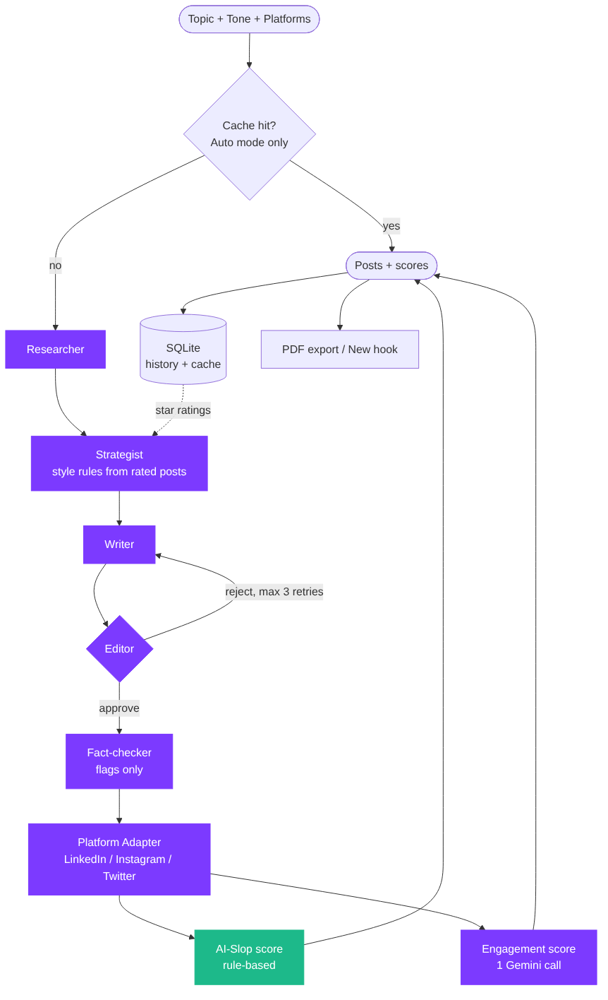

# Horizon AI

**Every idea deserves a bigger horizon.**


## The problem

Students and early-career developers build good projects but struggle to talk about them. Writing a post takes time, a single AI prompt gives generic text that sounds robotic, and every platform wants a different format (a long LinkedIn post, a short Instagram caption, a Twitter thread). Most people end up not posting at all, or posting something they would not stand behind.

## The solution

Horizon AI is a multi-agent content pipeline. You give it an idea, a tone and the platforms you care about. A team of AI agents researches it, writes it, edits it, fact-checks it and adapts it into ready-to-post content for **LinkedIn, Instagram and Twitter/X**.

Built with Python, LangGraph, the Google Gemini API, Streamlit and SQLite.



## How it works

| Step | Agent | What it does |
|------|-------|--------------|
| 1 | Researcher | Collects background and angles for the topic |
| 2 | Strategist | Learns your style from your star-rated posts and adds style rules (activates after 10 rated runs) |
| 3 | Writer | Writes the main draft in the chosen tone |
| 4 | Editor | Approves or rejects the draft (up to 3 retries, then you edit manually) |
| 5 | Fact-checker | Flags risky claims. It only flags, it never blocks or edits |
| 6 | Platform Adapter | Turns the draft into LinkedIn, Instagram and Twitter posts |

After the posts are ready, two scores are added:

- **Human feel (AI-slop score):** rule-based, no API call. Checks the final posts for clichéd AI phrases and patterns, and shows exactly what it flagged.
- **Virality score:** one Gemini call rates the hook, call to action and emotion.

## Features

- **Auto and Review mode.** Auto runs end to end and only stops if the Editor rejects. Review mode lets you read and approve after research, draft, Editor and fact-check.
- **Human in the loop.** Reject a draft with your own feedback, or edit it by hand.
- **New hook.** Rewrites only the opening line of a post, so the rest stays word-for-word the same.
- **Caching.** The same topic and tone in Auto mode is served from a local cache for 7 days.
- **History and ratings.** Every run is saved. Star-rate posts to train the Strategist.
- **PDF export.** Download a clean content pack with posts, scores and fact-check status.
- **Cost estimate.** A rough per-run estimate (a flat rate per Gemini call, not real token billing).

## Setup

```bash
git clone <your-repo-url>
cd <your-repo-folder>
pip install -r requirements.txt
```

Add your Gemini API key. Get one from Google AI Studio.

```bash
# Windows (PowerShell)
$env:GEMINI_API_KEY="your-key"        # <-- check: use the variable name your gemini_client.py reads

# macOS / Linux
export GEMINI_API_KEY="your-key"
```

Run the app:

```bash
streamlit run app.py
```

## Project structure

```
app.py              Streamlit UI and the pipeline state machine
agents/             Researcher, Writer, Editor, Fact-checker, Platform Adapter,
                    Strategist, Slop detector, Engagement, Hook writer
prompts/            Prompt templates for each agent
utils/              Gemini client, SQLite history, cache, PDF export, JSON helpers
docs/               Architecture diagram
data/               Local SQLite database (created on first run, not committed)
```

## Limitations

- The Writer can invent personal anecdotes and specific numbers. The Fact-checker flags some of these, not all. Always read a post and replace made-up details with your own before publishing.
- The slop score is rule-based, so it is a useful signal, not a perfect judge.
- The cost shown is an estimate.
- The PDF uses standard fonts, so emojis and non-Latin text are dropped from the PDF (the app itself shows them).

## Author

Tamanna Tyagi 